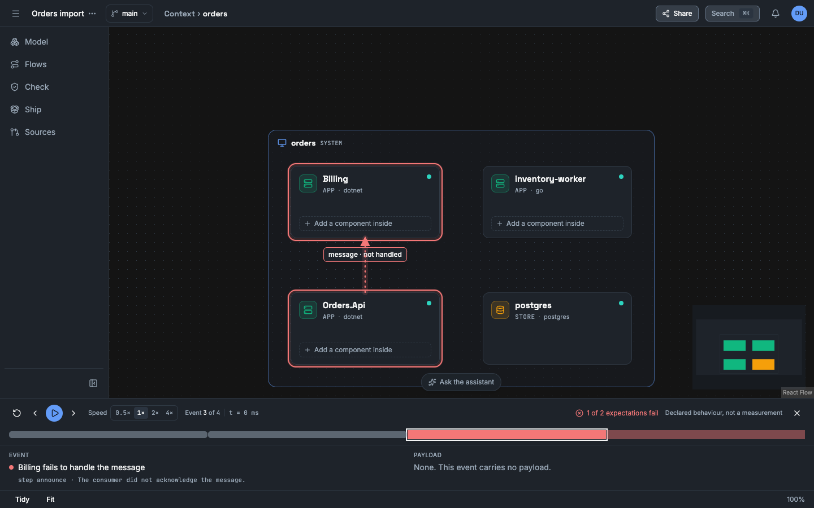
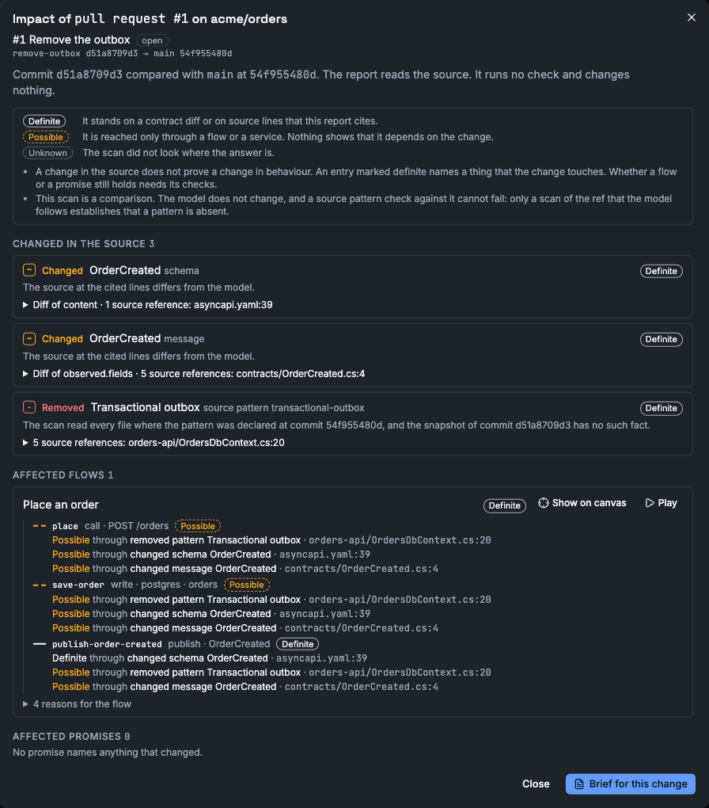

# Vellum

Vellum is an architecture workbench that you host yourself. You draw a system, declare
its APIs and events, play a flow through it, and state promises that the design must keep.
Vellum then gives a coding agent a specification to build from.


**Status: work in progress, not released.** No version is published. The data format can
change. Do not put it on a public address yet.

## What it looks like

A scenario plays on the canvas, one event at a time. Here Billing fails to handle a
message, and one of the two expectations fails.



A promise has a stable ID and obligations. Each obligation shows its evidence: passed,
failed or not run.


A scan of a pull request shows each flow step that the change can affect, with the source
lines that give the label.



## TL;DR

- One command starts the app and its database: `docker compose up -d`.
- You can model a system, import a GitHub repository as proposals, trace a flow with
  payloads and failures, declare promises, and export a specification for an agent.
- Everything Vellum shows has a label: `declared`, `observed-in-source`, `inferred`,
  `measured` or `unknown`. Nothing is called "verified" without evidence.
- An AI provider is optional. Vellum works without one.

## Quick start

You need Docker with the Compose plugin.

```sh
git clone https://github.com/alternayte/vellum
cd vellum
docker compose up -d --build
```

The first build takes some minutes. The app listens on `http://localhost:8080`.

Get the one-time setup code:

```sh
docker compose logs vellum | grep "VELLUM SETUP CODE"
```

Then:

1. Open `http://localhost:8080`. Vellum shows the setup screen.
2. Give your name, an email and a password. The password has 10 characters or more, with
   a digit, an upper-case letter and a lower-case letter.
3. Give the setup code and a name for the first workspace.
4. Open the workspace and create a project.

To read private GitHub repositories with your GitHub CLI login, start with
`just up-gh` instead. It passes `gh auth token` to Vellum as `GH_TOKEN`. Vellum does not
store it. See the docs page "Connect GitHub".

To use other ports, set `VELLUM_PORT` and `VELLUM_POSTGRES_PORT` before the command.
Compose publishes both ports on `127.0.0.1` only.

To stop: `docker compose stop`. To delete all data and the encryption key:
`docker compose down -v`.

## What works now

Each item below was run by hand against the current code: in a browser, or with an HTTP
client for the agent interface.

| Area | What you can do |
|---|---|
| Canvas | Add systems, apps, stores and actors. Connect them. Drill into a system: a frame shows the system around its children. Each card shows the kind, the technology and the description. Search. Tidy the layout. The detail panel has the tabs **Details** and **Connections**. |
| Contracts | Declare operations, channels, subscriptions, bindings between channels, messages and JSON schemas. |
| Trace | Write a scenario of calls, publishes and writes. Add faults. Play it step by step and read each payload. A trace shows the declared design. It does not run your code. |
| Import | Scan a GitHub repository at one commit. Vellum reads .NET, Go, OpenAPI, AsyncAPI, Compose, Dockerfile and Kubernetes files, and proposes what it found with file and line. You accept or reject each proposal. |
| Assistant | With an AI provider: ask for a flow or for model additions in words, review the proposal, then accept it. Additions get the label `inferred`. |
| Promises | State a requirement with a stable ID such as `ORD-014`. An owner approves it. Checks give evidence for it, and a result goes stale when its inputs change. |
| Impact | Scan a branch or a pull request and compare it with the ref that the model follows. Vellum labels each changed fact, flow step and promise `definite`, `possible` or `unknown`, and shows the steps on the canvas. A CI job can read a compact report and an opt-in gate. Vellum writes nothing to GitHub. |
| Drafts and variants | Change the model in a draft, read the diff and merge it into main. Keep a variant next to main, save named revisions and compare two models. |
| Review | 18 fixed rules report concerns about resilience, contracts, truth labels and needless complexity. Record a decision (ADR) to settle a finding. |
| Build | Export a standalone `SDD.md` and a bundle with OpenAPI, AsyncAPI, scenarios and promises. The same model gives the same bytes. Vellum can check a bundle against its source. |
| Agents | Create an agent token. A coding agent connects over MCP at `/mcp` and reads the model, proposes draft promises and exports the specification. A token cannot approve anything. |
| Costs | Enter prices, or fetch one from the public Azure price API. Vellum ships no price table. A resource with no price shows as unknown, never as zero. |
| Stress | Simulate one scenario under load with a fixed seed. The result is an estimate and lists what the model leaves out. |
| Settings | AI providers (OpenAI, Anthropic, Gemini, OpenAI-compatible), GitHub token, limits, encrypted secrets, key rotation, audit log. |

## What is not done

- Imports and AI calls were tested against local stand-in servers only. No run against the
  real GitHub API or a real AI provider is recorded yet.
- Generated k6 load tests and measured results were run against a local stand-in service
  only, not against a deployed system.
- The hosted, multi-tenant profile ran behind a local TLS proxy with a self-signed
  certificate only. No run used a real reverse proxy. Use the local profile for real work.
- No run sent telemetry to a real OpenTelemetry collector.
- Some actions have no control in the app and work through the HTTP API only: set the
  kind of a relationship, and read the findings of a named revision. The how-to guides
  say where.
- There is no licence file yet.

`PROGRESS.md` holds the exact state of each build step and the evidence for it.

## Connect a coding agent

1. In the app, open the workspace settings, then **Agent tokens**. Create a token.
2. Give the token to your MCP client as a bearer header. For Claude Code:

```sh
claude mcp add --transport http vellum http://localhost:8080/mcp \
  --header "Authorization: Bearer <token>"
```

`http://localhost:8080/llms.txt` describes the agent interface. The agent skill is in
`skills/vellum/SKILL.md`.

## Develop

You need the .NET 10 SDK, Node.js and Docker.

```sh
docker compose up -d postgres        # the database only
dotnet run --project src/Vellum      # the API
cd src/Vellum.Web && npm install && npm run dev   # the web client, http://localhost:5173
```

Run the tests. The backend tests start Postgres in Docker.

```sh
just test          # the backend tests without Category=Slow
just test-slow     # the backend tests that take long by design
cd src/Vellum.Web && npx vitest run   # the web client tests
```

CI (`.github/workflows/ci.yml`) runs on each push to `main` and on each pull request. The
backend tests run in 6 shards at the same time, and the whole run takes about 3 minutes.
The slow tests run each night, on a `v*` tag and on a manual start.

`just check` is the gate before a commit: build, code style, lint, type checks, the docs
build with its link check, and the docs snippet checks. It needs `just`, Node.js and Docker.

The documentation is published at https://vellum-docs-5fy.pages.dev. Read it as a site on
your machine:

```sh
just docs          # live reload at http://localhost:4321
just docs-build    # writes site/dist and fails on a broken internal link
```

## Layout

| Path | Content |
|---|---|
| `src/Vellum` | The API. A modular monolith on .NET 10 with Postgres. One folder for each feature under `Modules/`. |
| `src/Vellum.Web` | The web client. React 19 and React Flow. |
| `tests/Vellum.Tests` | Backend tests and fixture repositories. |
| `site` | The documentation site (Starlight). The pages are in `site/src/content/docs`: tutorials, how-to guides, concepts, reference, troubleshooting and runbooks. |
| `examples/orders` | A model of the Orders reference case that you can import, with two scenarios. |
| `examples/github-standin` | A stand-in for the GitHub API that serves the fixture repositories, for an import with no GitHub account. |
| `skills/vellum` | The skill that tells a coding agent how to use Vellum. |
| `Vellum-SDD.md` | The product contract. |
| `PROGRESS.md` | The build log and the current state. |

## Read more

- [Run Vellum on your machine](site/src/content/docs/tutorials/self-host-quickstart.md)
- [Model your first system and trace a flow](site/src/content/docs/tutorials/first-model-and-trace.md)
- [Import a repository and review the proposals](site/src/content/docs/tutorials/import-and-review.md)
- [The promise loop: from a question to evidence](site/src/content/docs/tutorials/promise-loop.md)
- [Back up and restore](site/src/content/docs/runbooks/backup-and-restore.md)
- [Trace a scenario](site/src/content/docs/how-to/trace-a-scenario.md)
- [Import a repository](site/src/content/docs/how-to/import-a-repository.md)
- [Declare a promise](site/src/content/docs/how-to/declare-a-promise.md)
- [Export for an agent](site/src/content/docs/how-to/export-for-an-agent.md)
- [Connect a coding agent](site/src/content/docs/how-to/connect-a-coding-agent.md)
- [What leaves your instance](site/src/content/docs/concepts/what-leaves-your-instance.md)
