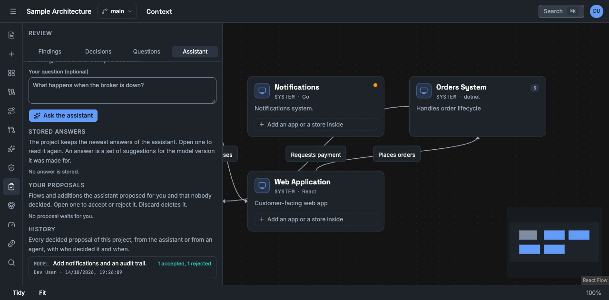

This guide shows you how to use the assistant. You need the editor role to ask for a proposal. A viewer can ask for an explanation.

The assistant needs an AI provider. See [Connect an AI provider](/how-to/connect-an-ai-provider/). Without one, the assistant says so, and the rest of Vellum works as before.

The assistant proposes. It never changes the model or a scenario by itself.

## Ask for a flow

1. Open the project and select **Assistant** in the left toolbar.
2. Select **Flow**.
3. Describe the behaviour in plain words. For example: "A customer places an order. Orders saves it and publishes OrderCreated. Show what happens when Billing fails."
4. Select **Propose a flow**.

The proposal opens. Nothing is saved yet.

## Read a flow proposal

| Part | Meaning |
|---|---|
| Steps that can be saved | The steps whose parts all exist in the model. The line below them says how many events the flow plays as. |
| Parts the flow needs and the model lacks | Things the flow uses that the model does not have. Select **Create** to add one. Vellum labels it inferred and records the proposal as its source. |
| Left out | Places where the assistant referred to something that does not exist. Vellum removed those parts. |
| Problems the trace check found | References or payloads that the trace engine refuses. |
| Questions the assistant could not answer | What the request left open. |

The assistant sees the parts of your model as a numbered table, without their real IDs. It can use only what is in that table. When it names something outside the table, Vellum leaves that out.

When the assistant asks for a part that the model already has, Vellum uses the existing part and says so.

## Decide

- **Accept and play** saves the flow as a scenario and plays it on the canvas.
- **Accept with these problems** saves a flow that has problems. Correct them in the scenario editor.
- **Reject** closes the proposal. Nothing is saved.

If the model changes after the assistant made the proposal, Vellum checks the proposal again and tells you. Decide again with the current check.

**Close** keeps the proposal undecided. A proposal costs tokens, so Vellum keeps it.

A scenario that came from a proposal records that origin.

## Ask for additions to the model

1. Select **Model** in the assistant panel.
2. Describe what to add. For example: "Add a notification service that listens to OrderCreated."
3. Select **Propose additions**.

The proposal lists each addition with the confidence the assistant states and its reason. Select the ones you want and select the accept button, for example **Accept 3**. Accepting an item also accepts what it needs.

![The dialog Proposed additions. It says that the suggestion is from stand-in-model, and that accepted items are added as inferred facts. The summary reads: A Notifications app in Fulfilment hears about each shipment and emails the customer a tracking link. Three items are selected: the element Notifications (app, Go, inside Fulfilment), the relationship Shipping worker to Notifications (reports shipments) and the relationship Notifications to Customer (emails tracking links). Each item has the label inferred and a confidence of 80% or 70%. The buttons are Close, Reject selected and Accept 3.](../../../assets/screenshots/assistant-proposed-additions.png)

Each accepted item is added with the label **inferred**. A proposal never changes or removes what is in the model.

The confidence is what the assistant claims. It is not a measurement.

## Find a proposal again

Select **Review** in the left toolbar, then the **Assistant** tab.

- **Your proposals** lists the flows and additions that the assistant made for you and that nobody decided. Select one to open it and decide. Select the bin to discard it. A discarded proposal is deleted.
- **History** lists every decided proposal of the project: the decision, who decided and when. Select one to read it.

Additions are decided item by item. Each item records who accepted or rejected it, and when. A proposal with a decided item cannot be discarded. Reject its other items to close it.

Each list shows 20 proposals of each kind. Select **Show more** for older ones.

## Ask for an explanation

1. Select an element on the canvas, or open a trace and go to an event.
2. Select **Explain** in the assistant panel.
3. Add a question if you want, and select **Explain**.

The answer appears as it is written. Select **Stop** to end it.

An explanation reads the declared model. It verifies nothing.

## Private repositories

Parts of the model that came from a private repository go to an AI provider only when a workspace owner allows it under **Settings → Privacy**. With that setting off, the assistant does not see those parts, and the proposal says how many it did not see.

## Limits

A project holds at most 50 undecided proposals. Accept, reject or discard old ones to make room. The assistant also limits how many requests one person and one project can make in a minute.

## Decide on a proposal from an agent

A coding agent with the `propose` scope can submit a flow or additions to the model. Vellum checks such a proposal as it checks a proposal of the assistant. A part that refers to an ID that names nothing is left out and listed. Nothing is in the model and no scenario is saved until you accept.

1. Open the assistant panel.
2. Below **Waiting for you**, select a proposal. Each line shows the token that submitted it.
3. Read the proposal. The line below the title names the token.
4. Accept or reject it, as you do for a proposal of the assistant.

A part of the model that you accept from such a proposal has the label `inferred`. Its source names the token and the proposal. An agent token cannot accept or reject a proposal.

A project holds at most 50 undecided proposals. Reject or accept one to make room.
