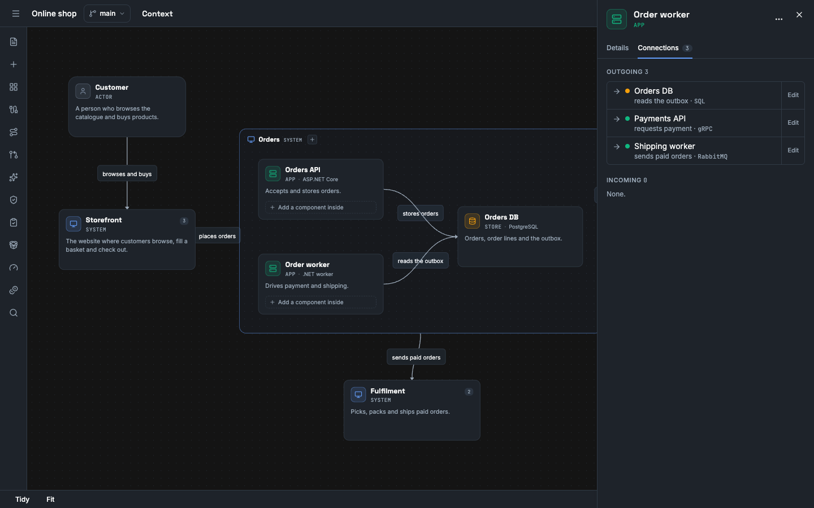

This guide shows you how to model a system: the elements, the relationships between them, the diagrams that show them and the messages that they exchange. You need the editor role in the workspace.

The model is the source of truth. The canvas shows the model. A change on the canvas writes to the model.

## Create a project

A new account starts in the empty project `My system`. To create another project:

1. In an open project, select the project menu (**⋯**) next to the project name.
2. Select **New project…**, enter a **Name** and select **Create**. Vellum opens the project.

On the home screen you can also select a workspace, then **+ New Project**.

An empty project shows three starts instead of a blank canvas. [Start a project](/how-to/start-a-project/) explains them. The link **Add a system** below them opens the dialog **Add Element**.

Vellum creates a diagram named `Default` the first time you open a project that has no diagram.

## Find the tools

The sidebar on the left has five areas. An area with more than one tool shows its tools as tabs.

| Area | Tools |
|---|---|
| **Model** | **Catalog**, **Contracts**, **Create** and **Files**. |
| **Flows** | The scenarios. |
| **Check** | **Review**, **Promises**, **Stress** and **Costs**. |
| **Ship** | **Build**, with the SDD export, and **Share links**. |
| **Sources** | The Sources of the project and their scans. |

**Check** and **Ship** show when the model has at least one element. **Share links** shows to an editor or an owner.

The assistant opens from **Ask the assistant** at the bottom of the canvas. The comments open from the bell in the top bar, on the **Comments** tab. The command palette (`Ctrl+K` or `Cmd+K`) opens each of these tools.

## Know the element kinds

A model has five kinds of element. Each kind has one permitted parent.

| Kind | Parent | Shortcut |
|---|---|---|
| Actor | None. An actor is at the top level. | `Shift+P` |
| System | None. A system is at the top level. | `Shift+S` |
| App | A system. | `Shift+A` |
| Store | A system. | `Shift+D` |
| Component | An app. | `Shift+X` |

The server refuses an element with the wrong parent. The answer is `400` with a message such as `App requires a parent of kind System`.

## Add an element

The canvas shows one level at a time. The top level is **Context**. A new element gets the level that you look at as its parent. Vellum offers only the kinds that the level permits.

Use one of these methods.

- Select **Model** in the sidebar, then the **Catalog** tab. Below **Elements**, select a kind.
- Press the shortcut of the kind.
- Double-click an empty part of the canvas. Select a kind.
- Right-click an empty part of the canvas. Select **Add Actor** or **Add System** (at the top level), or the kinds that the level permits.
- Press `N`. In **Add Element**, select the kind, enter a **Name** and select **Add**.
- Open the command palette with `Ctrl+K` or `Cmd+K`. Select **Add element**.
- Drag from the handle of an element to an empty part of the canvas. Select a kind. Vellum adds the element and a relationship from the first element to it.

Except for the **Add Element** dialog, a new element has the name `New <kind>`. Rename it in the detail panel.

## Go into a system or an app

1. Double-click a system or an app. As an alternative, right-click it and select **Drill into**.
2. Add the elements of that level. A frame with the name of the system or the app holds them.
3. Select **Context** or a name in the breadcrumb to go up.


**Expand** in the same menu shows the children in place, inside a frame on the current level. **Collapse** hides them again. An element with no child has no **Expand**.

A relationship between parts hidden inside two collapsed cards shows as a derived line between those cards. It is thinner than a relationship and has a count badge. Its label is the label of its one relationship, or "N relationships". Select it to list the relationships in the detail panel, then select an entry to open that relationship. A derived line is not stored. See [Views, levels and derived lines](/concepts/views-levels-and-derived-lines/).


To add the first child of a system or an app, right-click it and select **Add app inside**, **Add store inside** or **Add component inside**. As an alternative, select it and use the buttons below **Inside this system** in the detail panel, or select **Add an app or a store inside** on its card.

The import from GitHub and the assistant also add children when you accept their proposals. See [Import a repository](/how-to/import-a-repository/) and [Design with the assistant](/how-to/design-with-the-assistant/).

## Edit an element

1. Select the element. As an alternative, right-click it and select **Edit details**.
2. In the detail panel, on the tab **Details**, change **Name**, **Description**, **Technology**, **Status**, **Icon** or **Tags**.


The tab **Connections** lists the relationships of the element, outgoing and incoming. Select a row to go to the other element. Select **Edit** on a row to open the relationship.



**Status** is **Current**, **Planned** or **Deprecated**.

To copy an element, right-click it and select **Duplicate**, or press `Ctrl+D` or `Cmd+D`.

To delete an element, select the **⋯** button in the header of the detail panel, then select **Delete element**. As an alternative, right-click the element and select **Delete**. Vellum refuses to delete an element when an operation, a channel, a message or a scenario names it or an element inside it. The answer is `409` and the message lists the references. Remove or reassign them first.

To change more than one element, select two or more elements. The toolbar at the top shows the count as **selected**. Set the **Status**, enter a tag in **Add tag…** and press `Enter`, or select **Delete selected**.

`Ctrl+Z` or `Cmd+Z` reverses the last canvas action. Add `Shift` to do it again.

## Add a relationship

1. Drag from a handle of the source element to a handle of the target element. Each element has a handle on each side: top, right, bottom and left.
2. Select the relationship.
3. In the **Relationship** panel, enter a **Label** and a **Technology**.
4. Set the **Kind** to **Structural** or **Behavioural**. A structural relationship says that one part uses or depends on the other. A behavioural relationship says that one part calls or sends to the other at run time.
5. Set the **Line Style** to **Curved (Bezier)**, **Straight** or **Right-angle (Step)**.

### Choose the sides of a relationship

A new relationship has the side **Auto** at each end. An end with **Auto** attaches to the side that faces the other element. When you move an element, the end moves to the side that faces the other element. A relationship from an import or from an agent proposal also has **Auto** at each end.

To attach an end to a fixed side, do one of these steps:

- Select the relationship. Drag the dot at an end of the line to a handle on another side of the same element.
- Select the relationship. In the **Relationship** panel, set **Source side** or **Target side** to **Top**, **Right**, **Bottom** or **Left**.

Set the side to **Auto** to go back to the facing side.

A drop on another element does not change the relationship. To connect other elements, draw a new relationship.

The sides are part of the layout of the diagram, not of the model. Each diagram keeps its own sides. A side does not change the source or the target of the relationship, and it is not part of a draft or a revision. The SVG export uses the same sides.

The API endpoint is `PUT /api/projects/{projectId}/views/{viewId}/layout/edges/{relationshipId}`. The body is `{ "sourceSide": "top", "targetSide": null }`. A side is `top`, `right`, `bottom`, `left` or `null` for auto. Another value gets `400`. `GET /api/projects/{projectId}/views/{viewId}` returns the sides in `edges`.

To delete it, select the **⋯** button in the header of the panel, then select **Delete relationship**. Confirm **Delete this relationship?**.

A relationship that you draw is **Structural**. In the API the kind is `structural` or `behavioural`.

The server refuses a relationship when an end does not exist. The messages are `Source element not found` and `Target element not found`.

## Find an element

- Press `Ctrl+F` or `Cmd+F`. Enter text in **Search name, kind, technology, truth label...**. Press `Enter` to go to the next match. Press `Escape` to close.
- Press `Ctrl+K` or `Cmd+K`, or select **Search** in the top bar. Enter text in **Search elements, actions...** and select an element.

The command palette opens every tool of the sidebar, **Ask the assistant** and **Comments**. It also has these actions: **Add element**, **Toggle status lens**, **Toggle metadata lens**, **Toggle messages lens**, **Toggle truth labels**, **Tidy layout**, **Zoom to fit** and **Go to top level**.

## Arrange and save a diagram

A diagram is a saved view of the model. It has a name and a position for each element. Positions are layout. They are not part of the model and they carry no meaning.

1. Drag the elements. Vellum saves each position in the diagram.
2. To let Vellum arrange the diagram, press `T`, or right-click the canvas and select **Tidy layout**.
3. To see the full diagram, right-click the canvas and select **Zoom to fit**.
4. To add a diagram, select **Model** in the sidebar, then the **Create** tab, select **New Diagram**, enter a **Diagram name** and select **Create**.
5. To open a diagram, select **Model** in the sidebar, then the **Files** tab and select the diagram.

Each diagram shows the same model. An element that you delete is gone from each diagram.

## Rename or delete a diagram

1. Select **Model** in the sidebar, then the **Files** tab.
2. Point to the diagram and select its **⋯** button.
3. Select **Rename**, enter the new name and select **Rename**. Or select **Delete…**.

Before a delete, the dialog lists each document that embeds the diagram with a `<LiveView>` tag. Select **Delete diagram** to delete it. The diagram and its layout go. The elements and the relationships stay in the model. The text of each document stays as it is, and its embed shows **This diagram was deleted.**


The API calls are `PATCH /api/projects/{projectId}/views/{viewId}` and `DELETE /api/projects/{projectId}/views/{viewId}`. `GET /api/projects/{projectId}/docs?embedsViewId={viewId}` lists the documents that embed a diagram.

## Read the truth labels

Each element and relationship has a truth label.

| Label | Value in the API |
|---|---|
| **Declared** | `declared` |
| **Observed in source** | `observed-in-source` |
| **Inferred** | `inferred` |
| **Measured** | `measured` |
| **Unknown** | `unknown` |

1. Press `4`, or select **Toggle truth labels** in the command palette.
2. Read the **Truth labels** panel. It counts the labels and the **Structural** and **Behavioural** relationships that are on the screen.
3. Press `4` again to close the panel.

An element that you draw is **Declared**. An element from an import has the label of its evidence. See [Evidence and truth labels](/concepts/evidence-and-truth-labels/).

The detail panel of an element, a relationship or a message shows the label below **Truth**, with the source, the source revision, the confidence, and who accepted the fact, when and on which model version.

## Change a truth label

A person changes a label in two ways only. No control sets **Measured** or **Observed in source**: those labels claim evidence, and only an import or a measured result gives evidence.

| Label now | Action | Label after |
|---|---|---|
| **Inferred**, **Observed in source** or **Unknown** | **Accept as declared** | **Declared** |
| **Declared** | **Mark as unknown** | **Unknown** |
| **Measured** | None | **Measured** |

1. Select the element or the relationship. In the **Details** tab, find **Truth**.
2. Select **Accept as declared** or **Mark as unknown**.


You can also right-click the element or the relationship on the canvas and select the action. For an operation, a channel, a subscription or a binding, use the action on its row in **Contracts**.

The fact keeps its source, its source revision and its confidence. Vellum records you as the person who accepted it, the time, and the model version and branch that you accepted it on. **Truth** shows this as, for example, **by Dev User on 14/10/2026, 19:37:14 at model version 14**. In the API the fields are `acceptedBy`, `acceptedAt`, `acceptedAtVersion` and `acceptedOnBranch` in `provenance`. You need the editor role. A named revision is read-only, so it has no action.

The API endpoints are `POST /api/projects/{projectId}/facts/{entityType}/{entityId}/accept` and `POST /api/projects/{projectId}/facts/{entityType}/{entityId}/mark-unknown`. `entityType` is `element`, `relationship`, `message`, `operation`, `channel`, `subscription` or `binding`. Add `?branchId=<stream-id>` for a draft or a variant. The request has no body. An agent token gets `403`. A fact with another label gets `409` and the reason.

The other lenses are `1` for status, `2` for metadata and `3` for messages.

## Add JSON schemas and messages

A message is data that one element produces and other elements consume. A message can name a JSON schema.

To add them in the app, select **Model** in the sidebar, then the **Contracts** tab, then select **Add** next to **Schemas** or **Messages**. [Model your first system and trace a flow](/tutorials/first-model-and-trace/#add-the-message) shows the message form. To add them with the API, follow these steps.

1. Create the schema. The `content` is the JSON Schema as a string.

   ```sh
   curl -X POST "http://localhost:8080/api/projects/<project-id>/schemas" \
     -b vellum.cookies \
     -H "Content-Type: application/json" \
     -d '{"id":"<schema-uuid>","name":"OrderPlaced","description":null,"content":"{\"type\":\"object\",\"properties\":{\"orderId\":{\"type\":\"string\"}}}"}'
   ```

2. Create the message. Name the element that produces it and the elements that consume it.

   ```sh
   curl -X POST "http://localhost:8080/api/projects/<project-id>/messages" \
     -b vellum.cookies \
     -H "Content-Type: application/json" \
     -d '{"id":"<message-uuid>","name":"OrderPlaced","description":null,"producerId":"<element-id>","consumerIds":["<element-id>"],"schemaId":"<schema-uuid>","tags":[]}'
   ```

3. In the app, press `3` to show the messages on the canvas.
4. Select a message. The detail panel shows **Description**, **Producer**, **Consumers**, **Schema** and **Tags**.

The schema rules are these.

| Rule | Message in the `400` answer |
|---|---|
| The content is JSON. | `Content is not valid JSON` |
| The content is a JSON object. | `JSON Schema must be a JSON object` |
| The object has `type`, `properties` or `$schema`. | `JSON Schema must have a 'type', 'properties', or '$schema' property` |
| The content has at most 262144 characters. | `A schema holds at most 262144 characters; this one has <n>` |

A message with a producer that does not exist gets `Producer element not found`.

Change a schema with `PATCH /api/projects/{projectId}/schemas/{schemaId}` and a message with `PATCH /api/projects/{projectId}/messages/{messageId}`. Vellum refuses to delete a schema that the model still uses. The answer is `409`.

The `curl` examples use the session cookie of a signed-in person in the file `vellum.cookies`. [Use the HTTP API](/how-to/use-the-http-api/) shows how to sign in. An agent token cannot make the write calls on this page: those endpoints are not open to agent tokens and answer `403`.

## Next steps

- Operations, channels, subscriptions and scenarios: [Trace a scenario](/how-to/trace-a-scenario/).
- Text documents for the project: [Write project documents](/how-to/write-project-docs/).
- Copies of the model: [Save revisions and compare variants](/how-to/compare-variants/).
