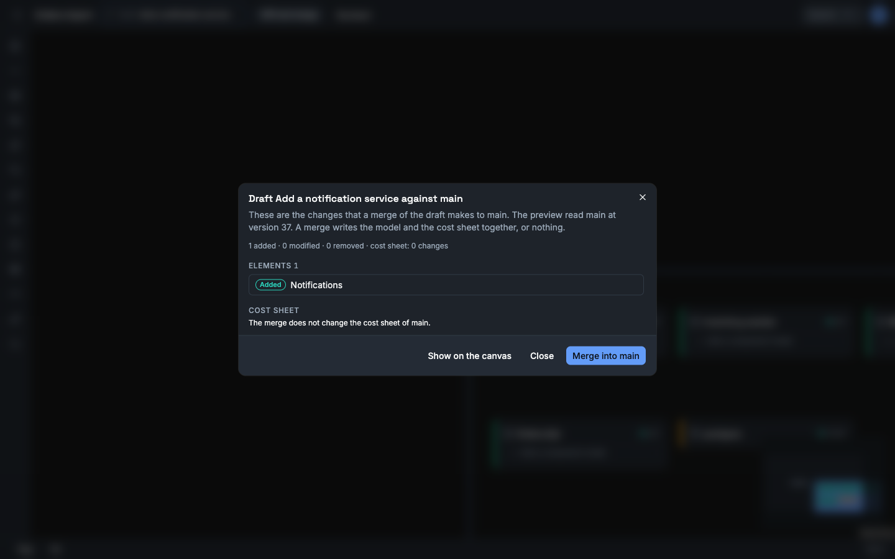

This guide shows you how to change the model in a draft and how to merge the draft into main. You need the editor role. A viewer can open a draft and read its diff.

## Find the model switcher

The model switcher is the button in the top bar of a project, to the right of the project name. It shows the model that the workbench shows: **main**, a draft, a variant or a revision.

1. Select the model switcher.
2. Read the list **Model shown**. It has the groups **Drafts**, **Variants** and **Revisions · read-only**.
3. Select a model to show it.

The actions below the list start a draft, a revision, a variant and a comparison.

## Create the draft

A draft is a copy of main at one version. Main can change while the draft is open.

1. Select the model switcher.
2. Select **New draft from main…**.
3. Enter a **Draft name**.
4. Select **Create draft**.

The workbench then shows the draft. The model switcher shows **Draft** and the name.

If the request fails, the dialog shows **No draft was created.** and the reason.

## Change the draft

Change the model as you do on main. Each change goes to the draft while the model switcher shows the draft.

These parts of the workbench follow the draft:

- The canvas, the detail panel and **Element catalog**.
- **Contracts**.
- **Costs**. The panel opens on the cost sheet of the draft.
- **Review**. The findings are the findings of the draft.
- **Scenarios** and **Stress**. A run uses the model of the draft.
- **Assistant**.

These parts do not follow the draft. Each of them says so in a note at the top of its panel.

| Panel | What it shows |
|---|---|
| **Project files** | Views and documents belong to the project. The model document is the document of main. |
| **Create new** | A diagram and a document belong to the project. |
| **Import** | An import reads main and its proposals change main. |
| **Promises** | Promises belong to the project. A check that you run in the panel plays on main. |
| **Build** | The build export and Build Ready read main. |

To go back to main, select the model switcher, then **main**.

## See the diff against main

1. Show the draft.
2. Select **Diff and merge** in the top bar. On a narrow screen, select the model switcher, then **Diff against main and merge…**.
3. Read the list. It shows each element, relationship, message, operation, channel, subscription and binding that the merge adds, changes or removes in main.
4. Select a row to see its fields in main and in the draft.

The part **Cost sheet** says how many resources and assumptions the merge changes in the cost sheet of main.

The dialog shows the merge preview of the server. It writes nothing.



To see the changes on the canvas, select **Show on the canvas**. The canvas then marks each changed element. Select **Close the diff** in the bar at the bottom to leave this view.

## Resolve the conflicts

A conflict is a change that needs a decision. The part **Conflicts** lists each one with the reason and with the fields of the two sides.

| Reason in the dialog | Conflict kind in the API |
|---|---|
| Main and the draft changed this in different ways. | `both_modified` |
| One side deleted this and the other side changed it. | `delete_modify` |
| One side deleted an element and the other side put a child in it. | `orphaned_child` |
| One side deleted this and a contract of the other side names it. | `referenced_by_contract` |
| The owner of this operation does not exist after the merge. | `dangling_operation` |
| This subscription names something that does not exist after the merge. | `dangling_subscription` |
| This binding names something that does not exist after the merge. | `dangling_binding` |

For each conflict, select one choice.

| Choice | Result |
|---|---|
| **Keep main** | Main keeps its value. |
| **Take the draft** | Main gets the value of the draft. If the draft deleted the item, main deletes it. |

A conflict between the two cost sheets has no choice. The dialog shows **The two cost sheets do not merge.** and the reasons. Open **Costs**. Change the sheet of the draft or of main until the two agree. Then open the diff again.

## Merge

1. Give each conflict a choice.
2. Select **Merge into main**.

The workbench then shows main, and a message says that the draft is merged.

The merge writes the model and the cost sheet together. If Vellum refuses the merge, it writes nothing, and the dialog shows **Nothing was merged.** and the reason.

| Reason | Fix |
|---|---|
| `Main has changed since preview. Please re-preview.` | Close the dialog. Open the diff again. |
| `The cost sheet of the draft does not merge into the cost sheet of main` | Change one of the two cost sheets until the two agree. |
| A sentence that names an item that points at nothing | The choices give a model that is not valid. Select other choices, or change the draft. |

## Abandon a draft

1. Show the draft.
2. Select the model switcher.
3. Select **Abandon this draft…**.
4. Select **Abandon draft**.

Vellum discards the changes of the draft and its cost sheet. Main does not change. An abandoned draft cannot be opened again.

## Use the API

The `curl` examples use the session cookie of a signed-in person in the file `vellum.cookies`. [Use the HTTP API](/how-to/use-the-http-api/) shows how to sign in. An agent token cannot make these calls: these endpoints are not open to agent tokens and answer `403`.

### Create a draft

Send the request. The `id` is a new UUID that you make.

```sh
curl -X POST "http://localhost:8080/api/projects/<project-id>/drafts" \
  -b vellum.cookies \
  -H "Content-Type: application/json" \
  -d '{"id":"<new-uuid>","name":"add-outbox"}'
```

Keep `id` (the draft ID) and `streamId` (the branch ID) of the answer.

```json
{
  "id": "7f0c1a52-3f0e-4d53-9a55-0f6f4a2f6c11",
  "projectId": "b1b0e6b0-1a0c-4c62-8a34-2a6a2a0a7d10",
  "name": "add-outbox",
  "streamId": "2b9d2c0e-9a0b-4a47-8a53-5f1a0c7a3e90",
  "baseStreamId": "5a3d8f6e-0b7a-4e0e-9d0b-0c9d1a1b2c3d",
  "forkVersion": 42,
  "status": "open",
  "createdBy": "0d7c5b1e-6a2f-4b3c-8d9e-1f2a3b4c5d6e",
  "createdAt": "2026-01-12T09:30:00+00:00",
  "mergedAt": null,
  "abandonedAt": null
}
```

`GET /api/projects/{projectId}/drafts` lists the drafts. `GET /api/projects/{projectId}/drafts/{draftId}` gives one.

### Change a draft

Add `?branchId=<streamId>` to a model request. The request then reads or writes the draft and not main.

```sh
curl -X POST "http://localhost:8080/api/projects/<project-id>/elements?branchId=<stream-id>" \
  -b vellum.cookies \
  -H "Content-Type: application/json" \
  -d '{"id":"<new-uuid>","kind":"store","name":"Outbox","description":null,"technology":"PostgreSQL","ownerId":null,"status":"planned","parentId":"<system-id>","tags":[]}'
```

The endpoints for elements, relationships, messages, operations, channels, subscriptions and bindings accept `branchId`. So do the cost endpoints, the scenario run, the stress run, the review findings and the build manifest.

A write to a draft that is merged or abandoned gets `400` with the error type `invalid_branch`.

To give the draft the cost sheet of main, send `POST /api/projects/{projectId}/costs/copy` with `?branchId=<streamId>` and the body `{"from":"main"}`.

### Add a comment

A comment on a draft is a thread with the `draftId` of the draft. The target must exist on the draft. You need the Commenter role.

```sh
curl -X POST "http://localhost:8080/api/projects/<project-id>/threads" \
  -b vellum.cookies \
  -H "Content-Type: application/json" \
  -d '{"draftId":"<draft-id>","target":{"kind":"element","id":"<element-id>"},"body":"Why a store and not a table in the orders database?"}'
```

`GET /api/projects/{projectId}/threads?draftId=<draft-id>` lists the threads of the draft. When the draft merges, its open threads move to main with their targets. See [Comment on a design](/how-to/comment-on-a-design/).

In the app, the detail panel shows the threads of an element while the draft is selected.

### Preview the merge

```sh
curl -X POST "http://localhost:8080/api/projects/<project-id>/drafts/<draft-id>/merge/preview" \
  -b vellum.cookies
```

The preview writes nothing. A viewer can call it.

```json
{
  "autoResolved": [
    {
      "entityType": "element",
      "entityId": "c4a8f6de-58a3-4b55-93a3-1b8c0b6c5f01",
      "changeKind": "added",
      "resolvedValue": { "name": "Outbox", "kind": "store" }
    }
  ],
  "conflicts": [
    {
      "entityType": "element",
      "entityId": "e2c1d7aa-0f43-4a8e-b8f4-6a2f0d9e7b22",
      "conflictKind": "both_modified",
      "baseValue": { "name": "Orders API" },
      "oursValue": { "name": "Order API" },
      "theirsValue": { "name": "Orders Service" }
    }
  ],
  "mainVersion": 45,
  "costSheet": { "changes": 1, "conflicts": [] }
}
```

| Field | Meaning |
|---|---|
| `autoResolved` | The changes that merge with no decision. `changeKind` is `added`, `modified` or `removed`. |
| `conflicts` | The changes that need a decision. |
| `baseValue` | The value when you created the draft. |
| `oursValue` | The value in main now. |
| `theirsValue` | The value in the draft. |
| `mainVersion` | The version of main that the preview read. Send it with the merge. |
| `costSheet.changes` | The number of resources and assumptions that the merge changes in the cost sheet of main. |
| `costSheet.conflicts` | The reasons why the two cost sheets do not merge. |

The values in the example are short. A real value is the full element, relationship, message, operation, channel or subscription.

### Merge

An error answer has the fields `type`, `title`, `detail` and `errors`.

Send the merge. Give one resolution for each conflict: `keep_ours` or `take_theirs`. Give the `mainVersion` of the preview as `expectedMainVersion`.

```sh
curl -X POST "http://localhost:8080/api/projects/<project-id>/drafts/<draft-id>/merge/execute" \
  -b vellum.cookies \
  -H "Content-Type: application/json" \
  -d '{"resolutions":[{"entityId":"<entity-id>","resolution":"take_theirs"}],"expectedMainVersion":45}'
```

The `status` of the draft in the answer is `merged`.

| Status | Message | Fix |
|---|---|---|
| `409` | `Main has changed since preview. Please re-preview.` | Preview again. Send the new `mainVersion`. |
| `400` | `<n> conflict(s) without resolution` | Add a resolution for each conflict. |
| `400` | `Duplicate resolution for entity <id>` | Send one resolution for each `entityId`. |
| `409`, type `cost_sheet_conflict` | `The cost sheet of the draft does not merge into the cost sheet of main` | Read `detail`. Change the cost sheet of the draft or of main until the two agree. Merge again. |
| `409` | `Draft is merged` or `Draft is abandoned` | The draft is closed. Create a new draft. |
| `409` | A sentence that names an item that points at nothing | The resolutions give a model that is not valid. Choose other resolutions, or change the draft. |

### Abandon a draft

```sh
curl -X POST "http://localhost:8080/api/projects/<project-id>/drafts/<draft-id>/abandon" \
  -b vellum.cookies
```

The `status` becomes `abandoned`.
