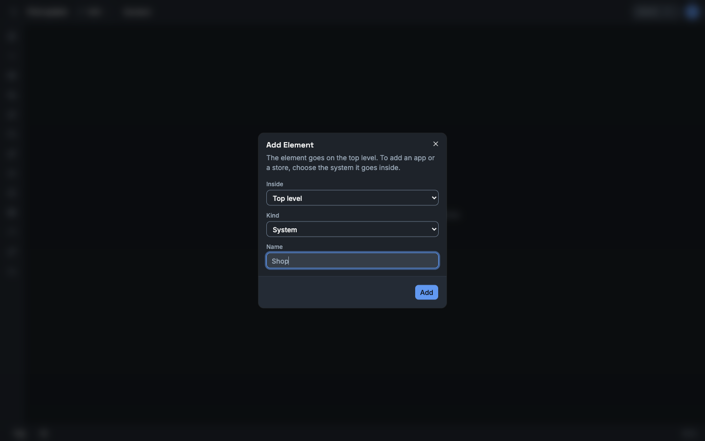
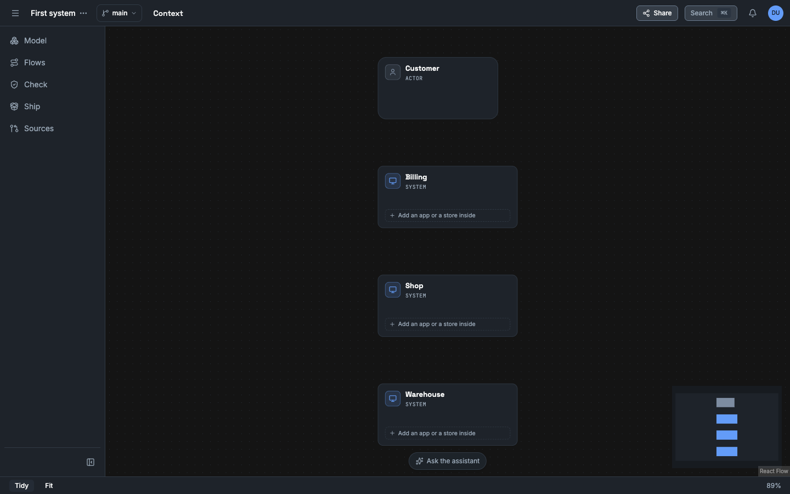
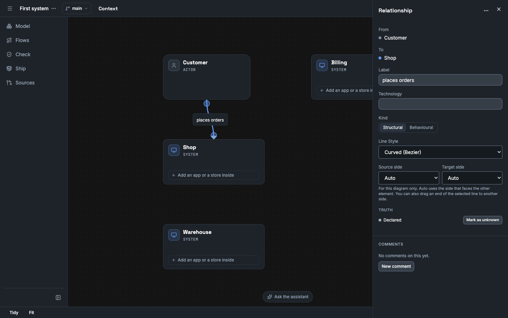
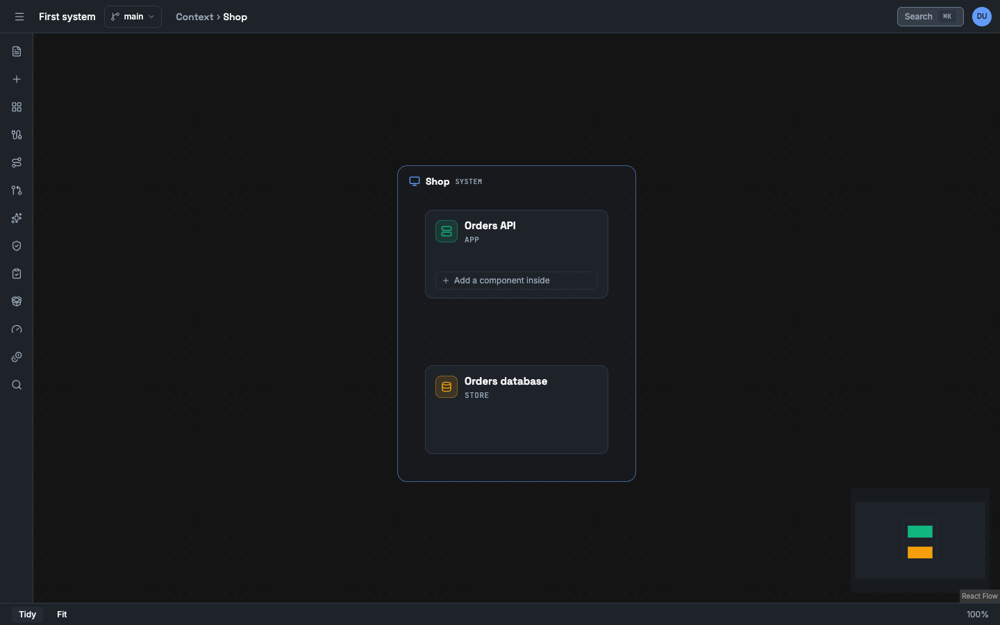

In this tutorial you model a shop that takes an order and tells two other systems about it. You then play the flow, make one consumer fail, and read what happens to the message.

You need no AI provider and no repository.

## Before you start

- Complete [Run Vellum on your machine](/tutorials/self-host-quickstart/). You are signed in as the owner of a workspace.

## Create a project

1. Select the project menu (**⋯**) next to the project name in the top bar.
2. Select **New project…**.
3. In **Name**, give `First system`. Select **Create**.

Vellum opens the project. The model has no element, so the project shows three starts: **Choose folder / GitHub URL**, **Describe it / Type it** and **Open the sample**. Below them is the link **Add a system**. This tutorial draws the model by hand. [Start a project](/how-to/start-a-project/) explains the three starts.

## Add the elements

1. Select **Add a system**. The dialog **Add Element** opens.
2. In **Name**, give `Shop`. Select **Add**.

   

3. Press `N`. The dialog opens again.
4. Select the kind **Actor**. Give the name `Customer`. Select **Add**.
5. Press `N`. Keep the kind **System**. Give the name `Billing`. Select **Add**.
6. Press `N`. Keep the kind **System**. Give the name `Warehouse`. Select **Add**.
7. Select **Tidy** at the bottom of the screen. Vellum arranges the four elements.

You now have one actor and three systems. Each has the label `declared`, because you state it.

The positions on the canvas are layout. They are not part of the model, and they change nothing in a trace.

## Connect two elements

1. Move the pointer over `Customer`. A handle shows on each side.
2. Drag from the handle on the right side of `Customer` to the handle at the top of `Shop`. A line starts at a handle on the left or the right side, and ends at a handle at the top or the bottom.
3. Select the new line. In the **Relationship** panel, give the **Label** `places orders`.

A relationship states structure: the customer uses the shop. It does not state behaviour. The line alone plays nothing. The contracts and the scenario of the next sections state the behaviour.

## Look inside a system

A system holds apps and stores. You add them at the level of the system.

1. Double-click `Shop`. The breadcrumb at the top shows **Context › Shop**, and the detail panel of `Shop` opens. Select the close button of the panel.
2. Select **Add Element**. The dialog shows `Shop (system)` in **Inside** and the kind **App**. Give the name `Orders API`. Select **Add**.
3. Press `N`. Select the kind **Store**. Give the name `Orders database`. Select **Add**.
4. Select **Tidy**. A frame with the name `Shop` holds the app and the store.

5. Select **Context** in the breadcrumb to go back to the top level. The card of `Shop` shows the number 2: it holds two elements.

The rest of this tutorial uses `Shop`, not the app or the store inside it.

## Declare the contracts

1. Select **Contracts** in the left toolbar.
2. Next to **Operations**, select **Add**. Give these values and select **Add operation**.

   | Field | Value |
   |---|---|
   | **Name** | `POST /orders` |
   | **Offered by** | `Shop` |
   | **Transport** | **HTTP** |
   | **Timeout (ms)** | `1000` |
   | **Attempts** | `1` |
   | **Backoff (ms)** | `0` |

3. Next to **Channels**, select **Add**. Give the **Name** `order-events` and the **Kind** **Topic**. Select **Add channel**.
4. Select **Add** again. Give the **Name** `order-events.dlq` and the **Kind** **Queue**. Select **Add channel**.
5. Next to **Subscriptions**, select **Add**. Give these values and select **Add subscription**.

   | Field | Value |
   |---|---|
   | **Channel** | `order-events` |
   | **Consumer** | `Billing` |
   | **Attempts** | `2` |
   | **Backoff (ms)** | `100` |
   | **Dead-letter channel** | `order-events.dlq` |

6. Select **Add** again. Give the **Channel** `order-events` and the **Consumer** `Warehouse`. Keep **Attempts** at `1`. Keep **Dead-letter channel** at **None: a failed message is lost**. Select **Add subscription**.

The flyout now lists one operation, two channels and two subscriptions: **Billing on order-events** and **Warehouse on order-events**.

## Add the message

A publish step names a message.

1. In **Contracts**, next to **Messages**, select **Add**.
2. Give these values and select **Add message**.

   | Field | Value |
   |---|---|
   | **Name** | `OrderCreated` |
   | **Producer** | `Shop` |
   | **Schema** | **None** |
   | **Consumers** | `Billing` and `Warehouse` |

The flyout lists the message as **Shop → Billing, Warehouse · no schema**. The message has the label `declared`.

## Write the scenario

A scenario is the steps of one behaviour, in order. You build it in the scenario editor. You select each element and each contract by its name.

1. Select **Scenarios** in the left toolbar, then **New**.
2. In **Name**, give `Place an order`.
3. Below **Steps**, select **Call**. The editor adds a call step with the mark **Trigger**.
4. In **Caller**, select `Customer`. In **Operation**, select `POST /orders`. The editor shows that Shop serves the operation, with its timeout of 1000 ms.
5. In **Request**, give `{"sku": "apple", "qty": 2}`. In **Response**, give `{"orderId": "o-1"}`.
6. At the top right of the step, change the step ID `call-1` to `place`. Press Enter.
7. Below the call step, in the last **Add** row, select **Publish**. The **Add** rows inside the call add steps inside the call.
8. In **Message**, select `OrderCreated`. The editor sets **Publisher** to `Shop`, the producer of the message.
9. In **Channel**, select `order-events`. **Consumers** now lists **Billing on order-events** and **Warehouse on order-events**. Each subscription receives the message. You do not add steps for them in this tutorial.
10. In **Payload**, give `{"orderId": "o-1"}`. Change the step ID to `announce`. Press Enter.
11. Below **Expected results**, select **Step outcome**. In **Step**, select `place`. Keep **Ends** at **Succeeded**.
12. Select **Event count**. In **Exactly**, give `2`. In **Events**, select **deliveries (Delivered)**. Keep **For** at **Any part**.
13. Select **Save and play**.

The scenario has two steps. `place` is a call from the customer to `POST /orders`. `announce` publishes `OrderCreated` to `order-events`. The two expected results state what you expect: the call succeeds, and the trace has two deliveries. The editor gives them the IDs `expect-1` and `expect-2`.

Select **JSON** in the editor to see the same scenario as the server stores it. The steps refer to each part by its ID.

## Play the flow

The dock at the bottom of the canvas opens. It always shows the line "Declared behaviour, not a measurement".

1. Select **Play**. Vellum moves through five events. The canvas shows a ring on the elements that take part in each event.

   | Event | Text in the dock |
   |---|---|
   | 1 | Customer calls POST /orders on Shop |
   | 2 | Shop responds to Customer for POST /orders |
   | 3 | Shop publishes OrderCreated to order-events |
   | 4 | Warehouse receives OrderCreated |
   | 5 | Billing receives OrderCreated |

2. Select **Restart**, then select **Next event** two times. The dock shows event 2 and its payload: the response with `orderId`.
3. Read the right side of the dock: **2 expectations hold**.

   
4. Select **Close trace**.

Vellum did not call a system. It played what you declared: one operation, one channel, two subscriptions and two steps. The same model and the same scenario always give the same events.

## Make a consumer fail

Now ask a question: what happens to the message when Billing cannot handle it?

1. Select **Scenarios**. Select the edit button on the row **Place an order**.
2. Below **Failures to inject**, select **Add a failure**. In **Target**, select **Billing on order-events**. Keep **Kind** at **Error**. In **Fails**, select **every attempt**.
3. Select **Save and play**.
4. Select **Play**. The trace now has ten events. The first five are the same. Then:

   | Event | Text in the dock |
   |---|---|
   | 6 | Billing fails to handle the message |
   | 7 | Retry 2 of Billing on order-events is scheduled |
   | 8 | Billing receives OrderCreated (attempt 2) |
   | 9 | Billing fails to handle the message (attempt 2) |
   | 10 | OrderCreated for Billing moves to order-events.dlq |

5. Read the right side of the dock: **1 of 2 expectations fail**. Select that text. The failed expectation is `expect-2`, with the reason "3 Delivered event(s); expected 2."

Read what the trace tells you:

- The subscription of Billing has two attempts and a backoff of 100 ms. The trace shows the second attempt. Time in a trace is virtual: only a timeout and a backoff move it.
- After the last attempt, the message moves to the dead-letter channel that you selected. It is not lost.
- The warehouse got the message one time and is not affected. A publisher does not wait for its consumers.
- The expectation counted deliveries, and a retry is a second delivery. An expectation that holds without a fault can fail with one. Decide what you want to state, and state it exactly.

To see a lost message, move the fault to the subscription of the warehouse, which has no dead-letter channel. The trace then has the event "OrderCreated for Warehouse is lost". No later event delivers that message.

## What you did

- You modelled six elements and one relationship, and each has the label `declared`.
- You declared one operation, two channels, two subscriptions and one message.
- You played a flow that the contracts permit, and you saw each payload.
- You injected a failure and read the retry and the dead-letter path.

## Limits that you met

- A trace shows the declared design. It does not show that your code does the same. See [A trace is declared behaviour](/concepts/traces-are-declared/).

## Next

- [Import a repository and review the proposals](/tutorials/import-and-review/)
- [Trace a scenario](/how-to/trace-a-scenario/)
- [Scenario format](/reference/scenario-format/)
