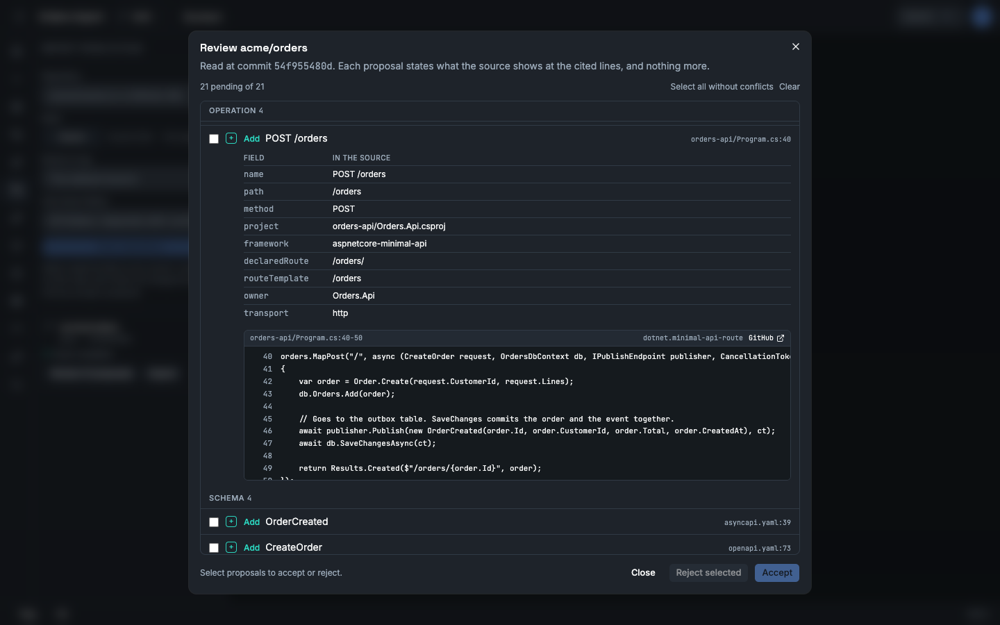
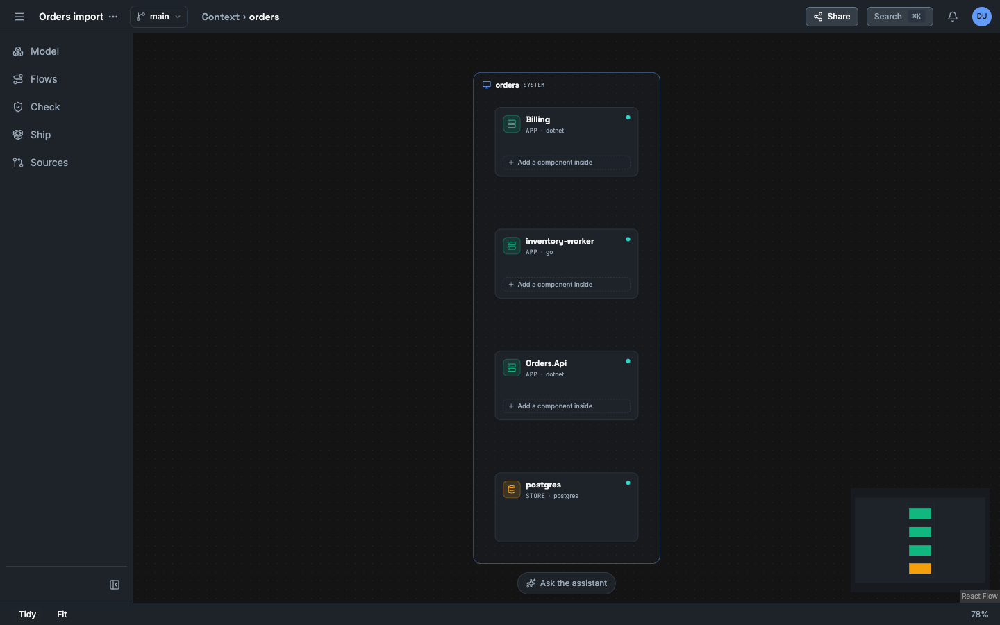

In this tutorial you scan a repository, read what Vellum found in it, and accept the findings into a model. The repository is the Orders fixture that the Vellum tests use. You need no GitHub account and no AI provider.

## Before you start

- Complete [Run Vellum on your machine](/tutorials/self-host-quickstart/). You are signed in as the owner of a workspace.
- You have the Vellum source on your machine, and Node.js 22 or later.

## What you scan

The directory `tests/Vellum.Tests/Fixtures/Repos/orders` holds a small system: an ASP.NET Core API, a .NET billing service, a Go inventory worker, an OpenAPI file, an AsyncAPI file and a Compose file.

Vellum reads repositories through the GitHub REST API. The script `examples/github-standin/server.mjs` answers the calls of that API from directories of your machine. It serves the fixture as the repository `acme/orders`:

| Ref | Directory | Content |
|---|---|---|
| `main` | `tests/Vellum.Tests/Fixtures/Repos/orders` | The system with a transactional outbox. |
| `remove-outbox` | `tests/Vellum.Tests/Fixtures/Repos/orders-outbox-removed` | A change that removes the outbox and gives one field of `OrderCreated` a new name. |

The stand-in also serves pull request #1, **Remove the outbox**, from `remove-outbox` into `main`.

To scan a repository on GitHub in place of the fixture, do not do the next two sections. Give `owner/name` of a public repository in the import form. [Connect GitHub](/how-to/connect-github/) shows how to read a private repository.

## Start the stand-in

1. In the directory of the Vellum source, start the stand-in. Keep it running in its own terminal.

   <!-- snippet: syntax -->
   ```sh
   node examples/github-standin/server.mjs
   ```

   It prints one line for each ref, with the commit SHA and the number of files, and then its address: `http://127.0.0.1:5299`.

2. In a second terminal, check that it answers.

   <!-- snippet: live -->
   ```sh
   curl -s http://127.0.0.1:5299/repos/acme/orders | jq -r '.full_name, .default_branch'
   ```

   The command prints `acme/orders` and `main`.

The commit SHA of a ref is a hash of the files in its directory. The same files always give the same SHA.

## Point the workspace at the stand-in

1. On the home screen, select your workspace, then select **Settings** next to its list of projects.
2. Select **GitHub**.
3. In **API base URL**, give the address of the stand-in as Vellum can reach it:
   - Vellum runs in Docker Compose on Docker Desktop: `http://host.docker.internal:5299`.
   - Vellum runs on your machine with `dotnet run`: `http://localhost:5299`.
4. Select **Save changes**.
5. Select **Test connection**. Vellum shows "Connected without a token: public repositories only." and the number of requests that remain.

The local profile accepts an address on a private network and plain `http`. The hosted profile refuses both by default.

On Linux with Docker Engine, the name `host.docker.internal` does not exist in a container by default. Start the stand-in with `--host 0.0.0.0`, and give the address of the Docker bridge of your machine, for example `http://172.17.0.1:5299`.

When you complete the tutorials, put the value `https://api.github.com` back.

## Scan the repository

1. In an open project, select the project menu (**⋯**), then **New project…**. In **Name**, give `Orders import`. Select **Create**. The project opens.
2. Select **Sources** in the sidebar.
3. In **Repository**, give `acme/orders`.
4. In **Read**, select **Branch**. In **Branch or tag**, give `main`.
5. Leave **Only these folders** empty.
6. Select **Scan repository**.

The scan shows "Listing files", then "Reading files", then "Scan complete". The button on the scan reads **Review 21 proposals**.

A scan reads one commit. It runs no code from the repository. It does not change the model.

## Review the proposals

1. Select **Review 21 proposals**. The dialog **Review acme/orders** opens. The line below the title gives the commit that the scan read.
2. Read the list. Vellum groups the proposals by kind. Each row has an action, a name and the first source line. In this scan every action is **Add**, because the model is empty.

   | Kind | Proposals |
   |---|---|
   | Element | `orders`, `postgres`, `Billing`, `inventory-worker`, `Orders.Api` |
   | Channel | `billing.order-created`, `inventory.order-created`, `order-events`, `order-events.dlx` |
   | Schema | `OrderCreated`, `CreateOrder`, `Order`, `OrderLine` |
   | Operation | `GET /healthz` (two services), `GET /orders/{id}`, `POST /orders` |
   | Binding | `inventory.order-created` bound to `order-events` |
   | Subscription | The consumer of Billing and the consumer of the inventory worker |
   | Message | `OrderCreated` |

3. Select the row **POST /orders**. The row opens. The table shows each field that the source gives. Below it, Vellum shows the lines that it read: `orders-api/Program.cs`, lines 40 to 50. The rule that found them is `dotnet.minimal-api-route`.
4. Select the row of the message **OrderCreated**. It has more than one source: the C# record in `contracts/OrderCreated.cs`, the message in `asyncapi.yaml`, the line that publishes it and the consumer in Billing.
5. Select **Select all without conflicts**.
6. Select **Accept 21**.



Vellum writes the 21 facts to the model. Each fact gets the label `observed-in-source`, the commit, the file and the lines, and your account as the person who accepted it.

To refuse a proposal, select it and select **Reject selected**. A later scan does not propose a rejected fact again while the source stays the same.

The link **GitHub** on a source line opens the file on the web address of the repository. The stand-in serves the API only, so the link does not open a page in this tutorial.

## Read what the model now holds

1. Close the dialog and the flyout. The canvas shows the system `orders`.
2. Right-click `orders` and select **Drill into**. The canvas shows `Orders.Api`, `Billing`, `inventory-worker` and `postgres`.
3. Select **Model** in the sidebar, then the **Contracts** tab. **Operations**, **Channels** and **Subscriptions** list what you accepted.



Three things are true about this model:

- **It holds what the source declares, and nothing more.** The source shows that `POST /orders` exists. It does not show how long the call takes, or that it works.
- **It has no behaviour.** The scan found no scenario. Lines in source code do not state the order of a flow. You declare a flow, or the assistant proposes one.
- **It has gaps.** The fixture binds the queue of Billing by a MassTransit convention that is not in the source. Vellum proposes no binding for it. A person adds that binding by hand in **Contracts**.

## Scan again

1. Open **Sources** and select **Scan repository** again, with the same values.
2. Select **Open review** on the new scan. The dialog shows "The source matches the model. This scan proposes no change."

A second scan of the same commit compares the source with the model and finds no difference.

## What you did

- You scanned one commit of a repository with no GitHub account.
- You read proposals with the file, the lines and the rule behind each one.
- You accepted them, and the model now labels each fact `observed-in-source`.

## Next

- [The promise loop: from a question to evidence](/tutorials/promise-loop/) uses this project and the ref `remove-outbox`.
- [Import a repository](/how-to/import-a-repository/)
- [Check the impact of a change](/how-to/check-change-impact/)
- [Extraction rules](/reference/extraction-rules/)
- [Evidence and truth labels](/concepts/evidence-and-truth-labels/)
